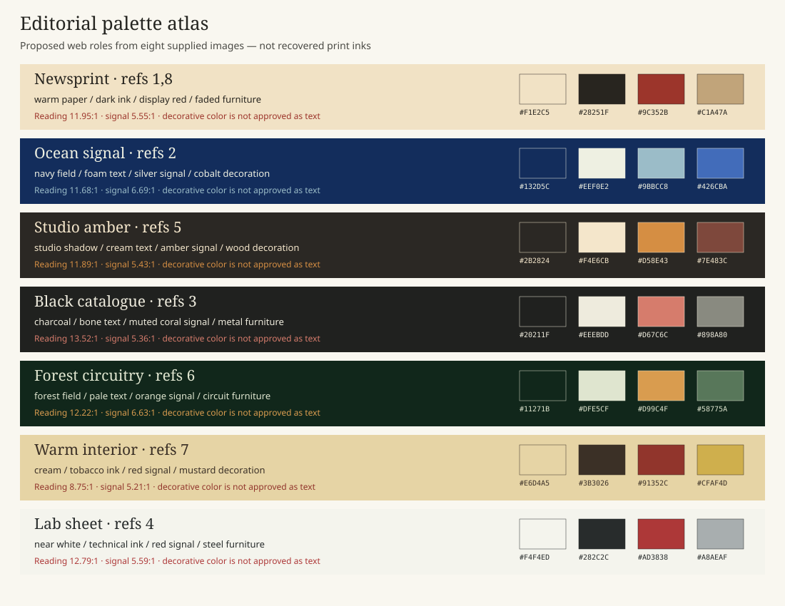

# Palette atlas

These seven families interpret the supplied references. The source samples in [image-palettes.json](image-palettes.json) are observed JPEG values. The colors below are **proposed web tokens**, adjusted for useful roles; they are neither original print inks nor approved final tokens.

Use one dominant family for an issue or feature spread. Keep masthead, section names, navigation and reading hierarchy stable. A quiet common journal frame can contain a saturated feature. Do not assign a color filter to photography or force a different palette onto each section.

| Family / image evidence | Surface | Reading text | Link / signal | Decorative furniture | Text contrast | Signal contrast |
| --- | --- | --- | --- | --- | --- | --- |
| Newsprint / 1,8 | `#F1E2C5` | `#28251F` | `#9C352B` | `#C1A47A` | 11.95:1 | 5.55:1 |
| Ocean signal / 2 | `#132D5C` | `#EEF0E2` | `#9BBCC8` | `#426CBA` | 11.68:1 | 6.69:1 |
| Studio amber / 5 | `#2B2824` | `#F4E6CB` | `#D58E43` | `#7E483C` | 11.89:1 | 5.43:1 |
| Black catalogue / 3 | `#20211F` | `#EEEBDD` | `#D67C6C` | `#898A80` | 13.52:1 | 5.36:1 |
| Forest circuitry / 6 | `#11271B` | `#DFE5CF` | `#D99C4F` | `#58775A` | 12.22:1 | 6.63:1 |
| Warm interior / 7 | `#E6D4A5` | `#3B3026` | `#91352C` | `#CFAF4D` | 8.75:1 | 5.21:1 |
| Lab sheet / 4 | `#F4F4ED` | `#282C2C` | `#AD3838` | `#A8AEAF` | 12.79:1 | 5.59:1 |

The ratios are computed from opaque solid sRGB pairs. They do not prove contrast in a rendered textured composition. Validate actual type size, overlays, focus states and photo backgrounds during development. Furniture colors are decorative only unless separately tested. The signal colors above pass 4.5:1 against their listed surface; color alone must not identify links.

## Composition and typography by family

| Family | Composition | Type relationship |
| --- | --- | --- |
| Newsprint | A dramatic headline/photo with indexed bands and ruled columns | Strong editorial display with readable serif prose and compact labels |
| Ocean signal | Broad saturated image field and silver/foam information inset | Clear strong display and restrained labels; no need to imitate Seiko lettering |
| Studio amber | Large scene above a bright or quiet detail band | Expressive headline over factual multi-column supporting copy |
| Black catalogue | Object/cover leads; a short caption anchors the lower field | Broad display silhouette and compact prose, with brand shapes kept out |
| Forest circuitry | Immersive feature scene with exact labels around its edges | Technical sans/mono metadata against a clear display title |
| Warm interior | Asymmetric photograph and quiet product-style fact band | A narrow side heading can become a horizontal English deck on mobile |
| Lab sheet | Generous white field with a precise functional label grid | Compact technical labels with deliberate hierarchy rather than microscopic text |

## Stable English type roles

Use a small font set with distinct display, reading and metadata roles. A display serif can support the newspaper rhythm; selected features can use strong sans display type. Use mono selectively for dates, instruments or technologies. Do not make every heading a mono terminal label. Reference letterforms are not a font license or a font identification. Choose real font files, licenses and loading budgets during implementation.

English headings wrap at meaningful phrases. Keep body measure readable, use real columns only where text flows sensibly, and keep captions subordinate but legible. The small print density of a scan is not a mobile font-size target. Vertical Japanese type can inform the placement of an English side label; it does not authorize vertical English paragraphs.
